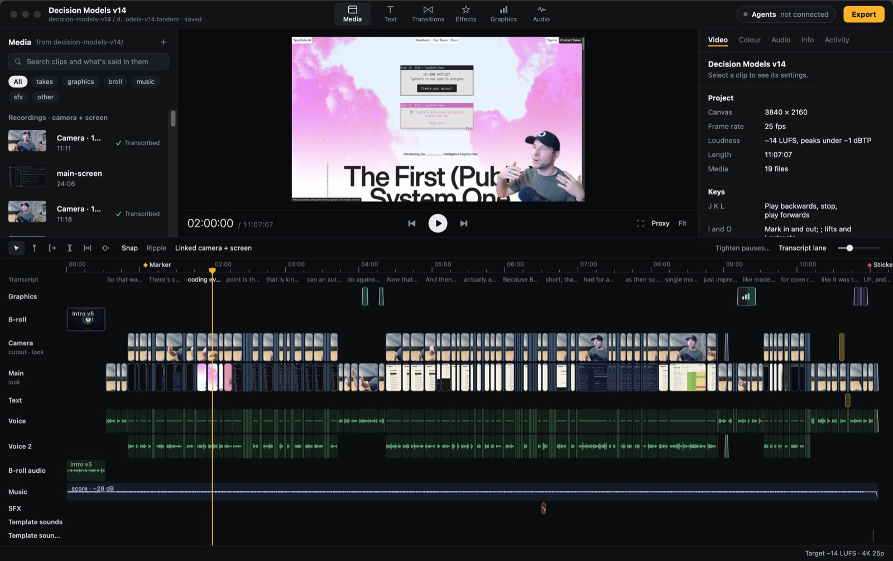

#  Substo Video

A video editor for a creator and their AI agents

macOS

<!-- media: hero -->
<!--  -->
<!-- media: hero -->

## What it is

Substo Video is a standalone macOS editor for the Substo content workspace, based on the upstream MIT editor. A creator and their agents can work on the same project through the app, CLI, or MCP server. See [Substo setup](docs/SUBSTO.md) for this copy's workflow and integration boundary.

A project is a `.substo` JSON file in the video's folder. Substo Video finds local media, recognises common camera and screen recording names, and runs transcripts, waveforms, and cutout work in the background. Check its media roles after import, since its original recording conventions may differ from yours.



## Get it running

You'll need macOS 15 or newer and Xcode 26 or newer with Swift 6. Some analysis
features, such as SpeechAnalyzer transcription, need macOS 26. SwiftPM fetches
the Lottie dependency during the first build. Install ffmpeg if you want to
import formats macOS can't decode, such as WebM (`brew install ffmpeg`).

```bash
cd "/Users/martingreen/Projects/Estio/video-editor"
bash setup_mac.sh
SUBSTO_SKILL_DIRS="" bash install.sh "$PWD/.local/bin"
"$PWD/.local/bin/substo" app
```

`setup_mac.sh` builds and signs the app at `~/Applications/Substo Video.app`.
This checkout defaults to a debug build because Xcode 26.3's Swift optimizer
currently crashes in the timeline view during a release build. Set
`SUBSTO_BUILD_CONFIGURATION=release` when that compiler issue is resolved.
`install.sh` links this clone's launcher into the supplied `.local/bin` directory
(or `~/.local/bin` when no directory is supplied). Add that directory to your PATH if needed.
Keep the clone in place, and rerun `install.sh` if you move it.

Without `SUBSTO_SKILL_DIRS=""`, `install.sh` also links [the Substo Video skill](skills/substo-video/SKILL.md) into
`~/.claude/skills` and `~/.agents/skills`, so Claude Code and Codex know how
to edit with Substo Video whenever they're in a folder with a `.substo` project:
the loop of editing, checking and handing back for review, and the rules.
Set `SUBSTO_SKILL_DIRS` to other folders, or to nothing to skip it. Agents
that use MCP instead (`substo mcp`) get the same guidance from the server.

Substo Video doesn't read `.env` files or need API keys to edit local media.
Optional asset providers use macOS Keychain. `substo assets providers` tells
you what's missing, and [the asset guide](docs/ASSETS.md) covers setup.

## Using it

`substo app [project.substo]` opens the editor. Every other command goes to
the agent CLI (`substo help`). For a new video folder:

```bash
cd /path/to/video
substo new Video.substo
substo app Video.substo
substo status
substo timeline --summary
```

For agents, add the MCP server once:

```bash
claude mcp add substo -- "$HOME/Applications/Substo Video.app/Contents/MacOS/substo" mcp
```

Old Filmora projects import with `substo import filmora "Video v3.wfp"`.
The built-in `decision-models` EDL recipe contains the creator's paths and style, so do not use it for Substo footage. The [agent guide](docs/AGENTS.md) is
the entry point for agents; its topic files in `docs/agents/` have the
recipes, import options and troubleshooting.

Stickers, graphics, sounds, music, looks, fonts and saved segments that
every video reuses live in `~/Movies/Substo Video Library`, which Substo Video makes
the first time it opens. Projects use those files where they are; `substo
archive` (File > Archive project...) copies the ones a project uses into it
before it moves to another Mac.

## Working on Substo Video

```bash
swift test
bash restart.sh
```

`restart.sh` builds a debug app and opens it. Set `SUBSTO_APP_DIR` to build
somewhere other than `~/Applications/Substo Video.app`.

Run `bash tests/install-tests.sh` to check the launcher installation without
touching your app. The default Swift tests use synthetic media and fixtures.
Real footage, live provider calls and paid generation use opt-in flags
documented in the guides. `SUBSTO_SPEECH_TESTS=1` enables the speech-service
test, which may install a language model and needs macOS 26.

| Doc | What's in it |
| --- | --- |
| `docs/ARCHITECTURE.md` | The contract between the modules: model, ripple modes, transforms, folders |
| `docs/PLAN.md` | The V1 task list and what's done |
| `docs/AGENTS.md` | The entry point for agents: setup, how editing works, and an index of every command, recipe and topic |
| `docs/agents/` | The agent guide's topic files: edit command semantics, JSON output, recipes, operations and troubleshooting |
| `docs/MEDIA.md` | Scanning, take pairing and the background analysis jobs |
| `docs/RENDER.md` | The compositor, transitions, titles, audio mix and export |
| `docs/ASSETS.md` | The asset library: sources, licences, normalising and credits |

## Layout

| Folder | What's there |
| --- | --- |
| `Sources/TandemCore` | Model, time, commands, editing, undo, journal |
| `Sources/TandemMedia` | Folder scanning, probing, analysis jobs |
| `Sources/TandemRender` | Composition, compositor, audio mix, export |
| `Sources/TandemAPI` | Project session, service, local server, MCP |
| `Sources/TandemAssets` | Asset library: catalogue, sources, normalising, credits |
| `Sources/TandemImport` | Filmora and EDL importers |
| `Sources/TandemApp` | The app |
| `Sources/TandemCLI` | The `substo` command |
| `tests/` | XCTest targets, one per library |

## Origin and licence

Based on [the original author's Tandem](https://github.com/mikecann/tandem). MIT licensed. See [LICENSE](LICENSE). Bundled fonts and other third-party
assets retain their own licences, which ship alongside them.
